<!-- Gerado por .github/scripts/build_readme.py. Configuração: assets/profile.json. -->

<a href="https://portfolio-frontend-jet-zeta.vercel.app/"><picture><source media="(prefers-reduced-motion: reduce) and (max-width: 600px)" srcset="./assets/hero-mobile-static.svg" /><source media="(prefers-reduced-motion: reduce)" srcset="./assets/hero-static.svg" /><source media="(max-width: 600px)" srcset="./assets/hero-mobile.svg" /></picture></a>
<a href="https://portfolio-frontend-jet-zeta.vercel.app/"><picture><source media="(max-width: 600px)" srcset="./assets/btn-portfolio-mobile.svg" />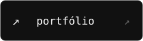</picture></a>
<a href="https://linkedin.com/in/pedro-henrique-b0a015391"><picture><source media="(max-width: 600px)" srcset="./assets/btn-linkedin-mobile.svg" />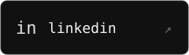</picture></a>
<a href="mailto:pedrohc.forza@gmail.com"><picture><source media="(max-width: 600px)" srcset="./assets/btn-email-mobile.svg" />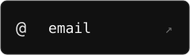</picture></a>
<a href="https://github.com/pedrhenriqueol"><picture><source media="(max-width: 600px)" srcset="./assets/btn-github-mobile.svg" />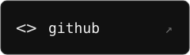</picture></a>
<a href="https://github.com/pedrhenriqueol/paystream-gateway"><picture><source media="(prefers-reduced-motion: reduce) and (max-width: 600px)" srcset="./assets/proj-paystream-mobile-static.svg" /><source media="(prefers-reduced-motion: reduce)" srcset="./assets/proj-paystream-static.svg" /><source media="(max-width: 600px)" srcset="./assets/proj-paystream-mobile.svg" />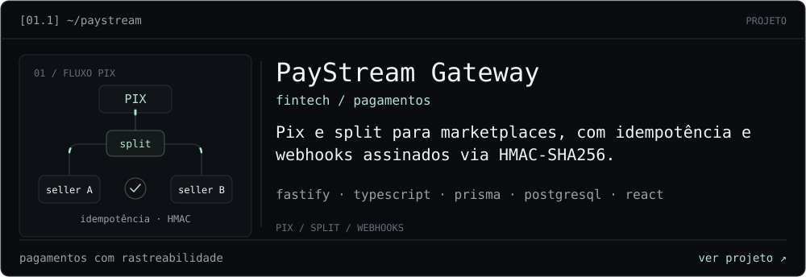</picture></a>
<a href="https://github.com/pedrhenriqueol/portlog-os"><picture><source media="(prefers-reduced-motion: reduce) and (max-width: 600px)" srcset="./assets/proj-portlog-mobile-static.svg" /><source media="(prefers-reduced-motion: reduce)" srcset="./assets/proj-portlog-static.svg" /><source media="(max-width: 600px)" srcset="./assets/proj-portlog-mobile.svg" />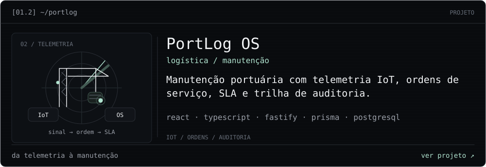</picture></a>
<a href="https://github.com/pedrhenriqueol/spectr-testops"><picture><source media="(prefers-reduced-motion: reduce) and (max-width: 600px)" srcset="./assets/proj-spectr-mobile-static.svg" /><source media="(prefers-reduced-motion: reduce)" srcset="./assets/proj-spectr-static.svg" /><source media="(max-width: 600px)" srcset="./assets/proj-spectr-mobile.svg" />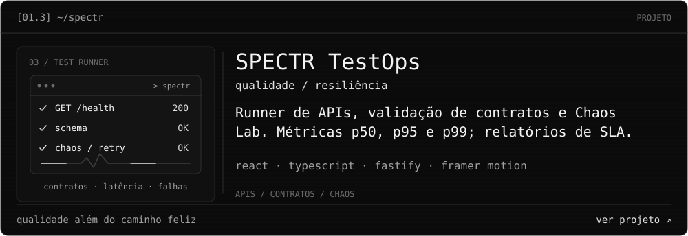</picture></a>
<a href="https://github.com/pedrhenriqueol/agente-pedro"><picture><source media="(prefers-reduced-motion: reduce) and (max-width: 600px)" srcset="./assets/proj-agente-pedro-mobile-static.svg" /><source media="(prefers-reduced-motion: reduce)" srcset="./assets/proj-agente-pedro-static.svg" /><source media="(max-width: 600px)" srcset="./assets/proj-agente-pedro-mobile.svg" />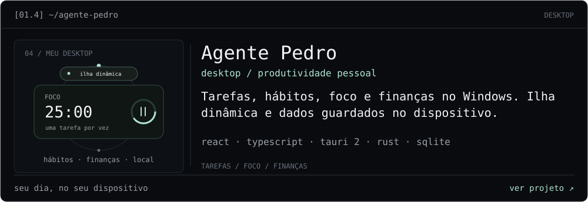</picture></a>
<picture><source media="(prefers-reduced-motion: reduce) and (max-width: 600px)" srcset="./assets/proj-erp-mobile-static.svg" /><source media="(prefers-reduced-motion: reduce)" srcset="./assets/proj-erp-static.svg" /><source media="(max-width: 600px)" srcset="./assets/proj-erp-mobile.svg" />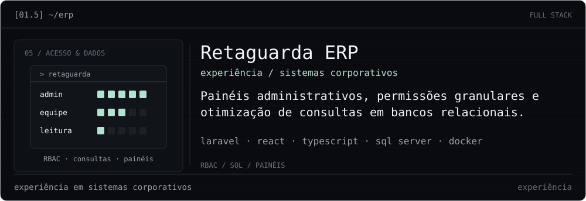</picture>
<picture><source media="(prefers-reduced-motion: reduce) and (max-width: 600px)" srcset="./assets/experience-mobile-static.svg" /><source media="(prefers-reduced-motion: reduce)" srcset="./assets/experience-static.svg" /><source media="(max-width: 600px)" srcset="./assets/experience-mobile.svg" /></picture>
<picture><source media="(prefers-reduced-motion: reduce) and (max-width: 600px)" srcset="./assets/stack-mobile-static.svg" /><source media="(prefers-reduced-motion: reduce)" srcset="./assets/stack-static.svg" /><source media="(max-width: 600px)" srcset="./assets/stack-mobile.svg" /></picture>
<picture><source media="(prefers-reduced-motion: reduce) and (max-width: 600px)" srcset="./assets/quality-mobile-static.svg" /><source media="(prefers-reduced-motion: reduce)" srcset="./assets/quality-static.svg" /><source media="(max-width: 600px)" srcset="./assets/quality-mobile.svg" /></picture>
<picture><source media="(prefers-reduced-motion: reduce) and (max-width: 600px)" srcset="./assets/certifications-mobile-static.svg" /><source media="(prefers-reduced-motion: reduce)" srcset="./assets/certifications-static.svg" /><source media="(max-width: 600px)" srcset="./assets/certifications-mobile.svg" /></picture>
<a href="https://github.com/pedrhenriqueol?tab=overview"><picture><source media="(prefers-reduced-motion: reduce) and (max-width: 600px)" srcset="./assets/contributions-mobile-static.svg" /><source media="(prefers-reduced-motion: reduce)" srcset="./assets/contributions-static.svg" /><source media="(max-width: 600px)" srcset="./assets/contributions-mobile.svg" /></picture></a>
<a href="mailto:pedrohc.forza@gmail.com"><picture><source media="(prefers-reduced-motion: reduce) and (max-width: 600px)" srcset="./assets/contact-mobile-static.svg" /><source media="(prefers-reduced-motion: reduce)" srcset="./assets/contact-static.svg" /><source media="(max-width: 600px)" srcset="./assets/contact-mobile.svg" /></picture></a>

